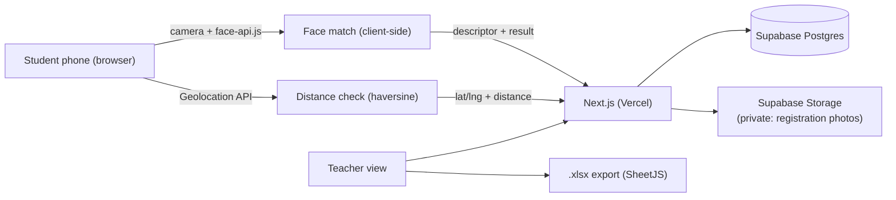

# Face Attendance System

> Working title — final product name is an open question (see `brain/PRD.md`).

Attendance by live selfie + live location. A student marks attendance from their own phone; the record is written **only** when their face matches their registered photo **and** their GPS position is inside the class radius. No paper register, no proxy attendance.

**Live demo:** TBD (Phase 0 deploy)
**Screenshots:** TBD (add after Phase 3)

-lightgrey)


## How it works

1. **Register** — name + roll number + live photo; a 128-d face descriptor is computed in the browser and stored.
2. **Verify** — live selfie → face match against the stored descriptor; browser Geolocation → haversine distance to the class location.
3. **Record** — face MATCHED + distance ≤ radius (default 100 m, teacher-configurable) → attendance row (date, time, match result, distance).
4. **Review** — teacher sees the log table and exports it as Excel (.xlsx).

## Architecture



Full detail: `brain/ARCHITECTURE.md`. Start here if you're an agent: `AGENT.md` → `brain/00-START-HERE.md`.

## Setup

```bash
npm install
cp .env.example .env.local   # fill in your Supabase values
npm run dev
```

Env vars: see `.env.example` and `brain/ENV.md`. Database schema + RLS: `brain/DATA_MODEL.md`.

## Scripts

| Script | Purpose |
|---|---|
| `npm run dev` | Local dev server |
| `npm run build` | Production build |
| `npm run lint` | Lint |
| `npm test` | Tests (core feature) |
| `npm run seed` | Seed demo students + demo class |

## Stack

Next.js (TypeScript) · Supabase (Postgres, Storage, RLS) · face-api.js (TinyFaceDetector + 128-d face descriptors, client-side) · Geolocation API · SheetJS (xlsx) · Vercel

## Team

Solo — Abdul Wahid (design, build, test, demo). See `brain/TEAM.md`.

## Privacy note

Face descriptors are biometric data. Consent at registration, private storage, deletion path — see `brain/ETHICS_PRIVACY.md`.

## License

TBD (needs human decision) — MIT is the default for Wadi's portfolio repos.
