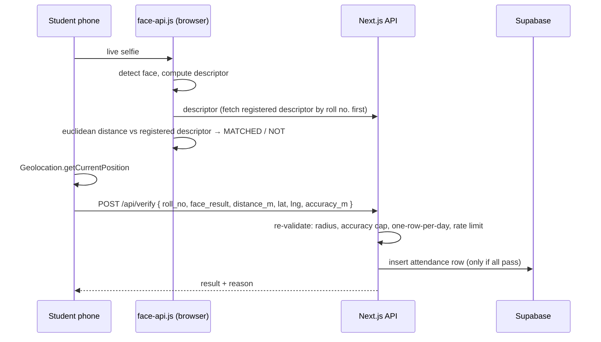

# ARCHITECTURE — Face Attendance System

## Stack (decided — rationale in DECISIONS.md)
| Layer | Choice |
|---|---|
| App | Next.js (App Router) + TypeScript, on Vercel |
| DB / Auth / Storage | Supabase (Postgres + Storage + RLS) |
| Face recognition | face-api.js in the browser — TinyFaceDetector + FaceLandmarks + FaceRecognition (128-d descriptors) |
| Location | Browser Geolocation API + haversine (own util, no dependency) |
| Export | SheetJS (`xlsx`) — client-side generation from fetched log rows |
| Validation | Zod at every boundary |

## Why matching runs client-side
- The descriptor is computed where the camera is; only the 128-float descriptor + result travel to the server.
- Zero backend hosting cost; no ML server to keep awake on free tiers.
- Fallback if accuracy disappoints: FastAPI + DeepFace service (see RISKS.md / DECISIONS.md ADR-005).

## Folder structure (as built — src/ OFF, folders at project root; corrected 2026-11-23, session 05)
```
  app/
    page.tsx              ← landing: Register / Verify / Teacher entry points
    register/page.tsx     ← registration form + camera capture
    verify/page.tsx       ← selfie + location check
    teacher/page.tsx      ← log table + export (teacher-only)
    teacher/settings/page.tsx ← class location + radius
    api/
      register/route.ts   ← validate + store student + descriptor
      verify/route.ts     ← validate + write attendance row (server re-checks distance + duplicate)
      log/route.ts        ← teacher-only log fetch
  components/
    CameraCapture.tsx     ← getUserMedia preview + capture, oval guide
    FaceStatus.tsx        ← match / no-face / multi-face states
    LocationStatus.tsx    ← GPS states: pending, denied, inaccurate, ok, too-far
    AttendanceTable.tsx
  lib/
    face.ts               ← model loading, descriptor extraction, euclidean match
    geo.ts                ← haversine, radius check, accuracy guard
    supabase/             ← client + server clients
    validation.ts         ← Zod schemas (single source)
public/
  models/                 ← face-api.js model weights (self-hosted)
brain/                    ← this documentation
```

## Data flow — verify (the core feature)


## Trust boundary (important)
- Face matching is client-side, so a tampered client could lie about `face_result`. For a portfolio/classroom v1 this is accepted and documented (RISKS.md R-04).
- The server still independently enforces: radius (recomputes haversine from submitted lat/lng vs stored class location), GPS accuracy cap, duplicate-per-day, rate limits.
- Hardening path (v2): server-side descriptor comparison — client sends the live descriptor, server computes the match. Schema already stores descriptors server-side, so this is a move, not a rewrite.

## Auth flow
- Students: no account. Identity = roll number + face. Registration is one-time per roll number.
- Teacher: Supabase Auth (single teacher account, email/password) OR a teacher PIN — TBD (needs human decision). Log + settings routes check the session server-side; RLS is the second wall (DATA_MODEL.md).

## Code conventions
- TypeScript strict; no `any` (use `unknown` + Zod parse).
- Feature-based folders; components never call Supabase directly — go through `lib/` or API routes.
- One error format everywhere: `{ ok: false, error: { code, message } }` (API_SPEC.md).
- Validate all input with the shared Zod schemas in `lib/validation.ts`.
- No hardcoded colours — DESIGN.md tokens only. No gradients.
- Model weights self-hosted in `public/models/` (no CDN dependency at runtime).

## Performance notes
- face-api.js models (~6–7 MB total for the three nets — verify at setup) load lazily on the register/verify pages only, with a loading state; never on the landing page.
- Descriptors are tiny (128 floats ≈ 1 KB as JSON) — no pagination concerns for one class.
